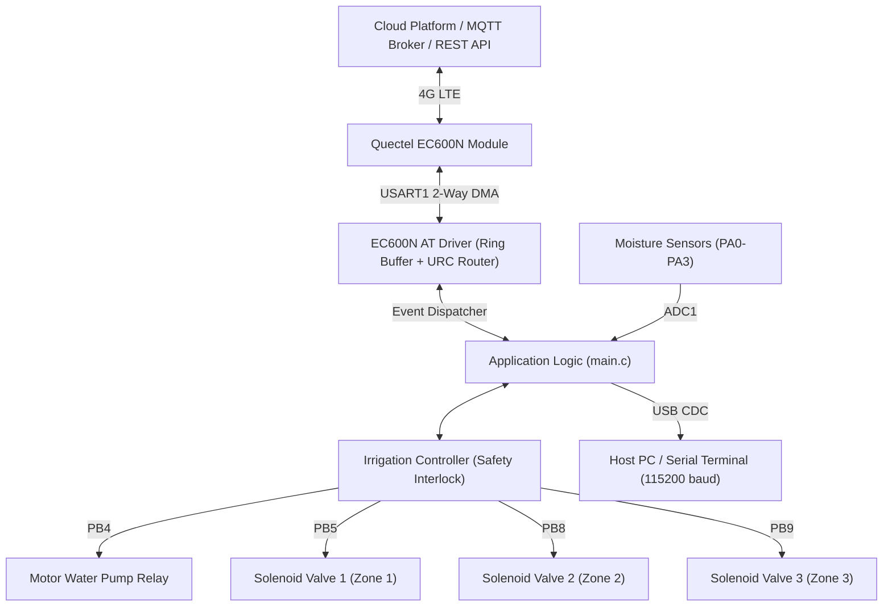
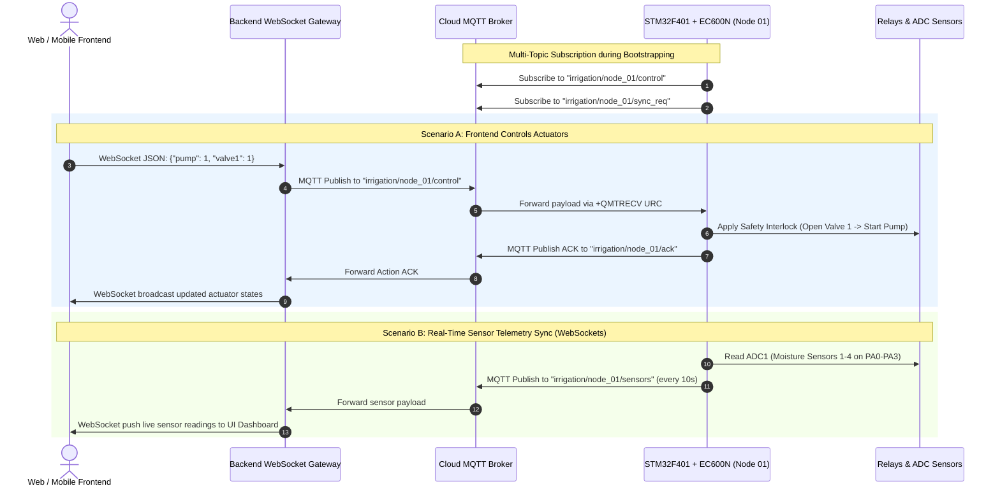

# IoT Irrigation System — Instruction & Usage Guide

**Firmware Target:** STM32F401CCU6 (BlackPill)  
**Cellular Modem:** Quectel EC600N-CN / EC600N-EU (Cat 1 LTE)  
**Communication Bus:** USART1 (2-Way DMA, 115200 baud)  
**Debug & Tracing:** USB CDC Virtual COM Port (Full-Speed USB)

---

## 1. System Overview & Architecture

This firmware powers an automated, cloud-connected agricultural irrigation system built on the STM32F401CCU6 MCU. It features a non-blocking Quectel EC600N 4G LTE AT command driver operating over USART1 with two-way Direct Memory Access (DMA), an integrated hydraulic actuator manager with safety interlock protection, and multiple cloud connectivity options (MQTT, HTTP REST, SMS).



### Key Hardware & Software Highlights
- **2-Way DMA USART Driver:** Complete zero-polling operation. RX utilizes `HAL_UARTEx_ReceiveToIdle_DMA` with UART IDLE line detection, pushing into a 2048-byte circular ring buffer. TX uses `HAL_UART_Transmit_DMA`.
- **Event Loop & Ring Buffer Processing:** The core function `ec600n_at_process()` (called via `ec600n_process()`) drains the software circular **FIFO ring buffer** (`ring_buf`), detects data prompts (`>`), and dispatches all asynchronous events (MQTT incoming data, SMS alerts, TCP socket events, network state changes). *Note: The term "ring" refers to this circular FIFO memory buffer in RAM, not a phone call/ringing event.*
- **Fault-Tolerant UART:** Hardware overrun (`ORE`), framing (`FE`), and noise (`NE`) errors trigger automatic DMA re-arming via `HAL_UART_ErrorCallback()`.
- **Hydraulic Safety Interlock:** Water pump operation is strictly forbidden if all valves are closed, guarding against pipe bursts and pump burnout.
- **Multi-Channel Remote Control:** Supports remote command processing via MQTT topics, HTTP GET polling, and SMS text messages.

---

## 2. Hardware Wiring & Pinout Guide

### 2.1 STM32F401 to Quectel EC600N Connections

| STM32F401 Pin | Pin Function | EC600N Pin | Description | Notes |
|---|---|---|---|---|
| **PA9** | USART1_TX | **RXD** | MCU transmit to modem | 3.3V CMOS compatible |
| **PA10** | USART1_RX | **TXD** | MCU receive from modem | 3.3V CMOS compatible |
| **GND** | Ground | **GND** | Common reference ground | Must be shared between STM32 and EC600N |
| *External Supply* | 3.8V – 4.2V (2A) | **VBAT** | Module power input | **Do not power from STM32 3.3V pin!** |

> [!CAUTION]
> **Power Supply Requirement:** The EC600N module draws current bursts of up to **2.0A** during 4G LTE transmission bursts. Power the module using a dedicated buck converter (e.g., LM2596, MP2307, or high-capacity lithium battery) rated for at least 2A with a 1000 µF low-ESR capacitor across `VBAT` and `GND`. Powering from the STM32 3.3V rail will cause brownouts and continuous MCU/modem reboots.

### 2.2 Actuator & Relay Pin Connections

| STM32 Pin | Label in Code | Target Component | Active Level | Default State |
|---|---|---|---|---|
| **PB4** | `motor_Pin` | Motor Water Pump Relay | `HIGH` (3.3V) = ON | `LOW` (OFF) |
| **PB5** | `valve1_Pin` | Solenoid Valve 1 Relay (Zone 1) | `HIGH` (3.3V) = OPEN | `LOW` (CLOSED) |
| **PB8** | `valve2_Pin` | Solenoid Valve 2 Relay (Zone 2) | `HIGH` (3.3V) = OPEN | `LOW` (CLOSED) |
| **PB9** | `valve3_Pin` | Solenoid Valve 3 Relay (Zone 3) | `HIGH` (3.3V) = OPEN | `LOW` (CLOSED) |

### 2.3 Sensor, LED & USB Pin Connections

| STM32 Pin | Function | Peripheral | Description |
|---|---|---|---|
| **PA0** | ADC1_IN0 | Soil Moisture Sensor 1 | Analog 0–3.3V input |
| **PA1** | ADC1_IN1 | Soil Moisture Sensor 2 | Analog 0–3.3V input |
| **PA2** | ADC1_IN2 | Soil Moisture Sensor 3 | Analog 0–3.3V input |
| **PA3** | ADC1_IN3 | Soil Moisture Sensor 4 | Analog 0–3.3V input |
| **PC13** | GPIO Output | Onboard Blue LED (`LED_MCU_Pin`) | Heartbeat indicator (toggles every 1s) |
| **PA11** | USB_DM | USB Full-Speed CDC | Serial monitor D- |
| **PA12** | USB_DP | USB Full-Speed CDC | Serial monitor D+ |

---

## 3. Safety Interlock Engine & Rules

The hydraulic controller ([`Core/Src/irrigation_ctrl.c`](file:///D:/Project_VSCode/IoT_Irrigation/firmware/Core/Src/irrigation_ctrl.c)) implements safety mechanisms to prevent pipe overpressurization and pump dry-running.

### 3.1 Interlock Rules

```mermaid
flowchart TD
    Req["Target State Requested (Pump + Valves)"]
    Req --> CheckValves{"Are 1, 2, or 3 valves OPEN?"}
    CheckValves -->|YES| AllowPump["Allow Pump State Request"]
    CheckValves -->|NO (0 valves open)| DenyPump["Force Pump = OFF\nFlag: IRRIGATION_WARN_INTERLOCK_TRIPPED"]
    AllowPump --> SeqSwitch["Hydraulic Switching Order:\n1. Open target valves\n2. Set pump state"]
    DenyPump --> SeqSwitch
```

1. **Pump Permission Rule:** The water pump is **ONLY** allowed to run if **at least one** valve (`valve1`, `valve2`, or `valve3`) is open.
2. **Auto-Clamping on Zero Valves:** If a command requests `pump: 1` when all valves are `0`, the firmware rejects the pump command, forces `pump = 0`, logs a safety alert, and returns status code `IRRIGATION_WARN_INTERLOCK_TRIPPED`.
3. **Emergency Auto-Shutdown:** If all open valves are closed while the pump is active, the pump is automatically deactivated.
4. **Hydraulic Sequence Order:**
   - **Starting:** Valves open **before** the pump starts to avoid dead-head pressure buildup.
   - **Stopping:** The pump is powered off **before** valves are closed.

### 3.2 C Controller APIs

```c
#include "irrigation_ctrl.h"

/* Initialize all actuator GPIOs to safe OFF state */
void irrigation_init(void);

/* Directly set actuator states through safety interlock */
irrigation_status_t irrigation_set_state(bool pump, bool v1, bool v2, bool v3);

/* Query current hardware state */
void irrigation_get_state(irrigation_state_t *state);

/* Immediate emergency shutdown (forces pump OFF first, then closes all valves) */
void irrigation_emergency_stop(void);

/* Check if pump is allowed based on candidate valve states */
bool irrigation_is_pump_allowed(bool v1, bool v2, bool v3);
```

---

## 4. REST API & Remote Control Payloads

Remote commands received via **MQTT**, **HTTP GET/POST**, or **SMS** are processed uniformly by `irrigation_process_rest_payload()`.

### 4.1 Supported Command Formats

#### A. Standard JSON Object
```json
{"pump": 1, "valve1": 1, "valve2": 0, "valve3": 0}
```
*(Also supports boolean values: `{"pump": true, "valve1": true, "valve2": false, "valve3": false}`)*

#### B. Shortened Key Format
```json
{"motor": 1, "v1": 1, "v2": 0, "v3": 0}
```

#### C. Valve Array Notation
```json
{"pump": 1, "valves": [1, 0, 1]}
```

#### D. URL Query String (HTTP GET / Webhook)
```
pump=1&valve1=1&valve2=0&valve3=0
```

### 4.2 Firmware JSON Responses

#### Success Response (`IRRIGATION_OK`):
```json
{
  "status": "ok",
  "pump": 1,
  "valve1": 1,
  "valve2": 0,
  "valve3": 0,
  "open_valves": 1
}
```

#### Safety Interlock Tripped Warning (`IRRIGATION_WARN_INTERLOCK_TRIPPED`):
```json
{
  "status": "warning",
  "error": "Safety Interlock: Pump denied because 0 valves are open",
  "pump": 0,
  "valve1": 0,
  "valve2": 0,
  "valve3": 0,
  "open_valves": 0
}
```

#### Parse Error Response (`IRRIGATION_ERR_PARSE`):
```json
{
  "status": "error",
  "message": "Invalid JSON/REST payload"
}
```

### 4.3 Multi-Topic Architecture & Real-Time WebSocket Synchronization

In real-world IoT deployments, a single MQTT topic is insufficient. The firmware is architected to handle multiple dedicated topics for:
1. **Actuator Control (Downlink):** Switching the 4 relays (Motor Pump + Solenoid Valves).
2. **Action Feedback / Acknowledgment (Uplink):** Immediate confirmation sent back to the backend when an action is executed.
3. **Sensor Telemetry Sync (Uplink / WebSocket):** Periodic or event-driven sensor broadcast that the backend streams over WebSockets to frontend dashboards in real time.
4. **On-Demand Sync Request (Downlink):** Allows the frontend to request immediate sensor readings without waiting for the periodic timer.



#### Detailed Multi-Topic Specification

| Topic Pattern | Direction | Purpose | Example Payload |
|---|---|---|---|
| `irrigation/{device_id}/control` | **Downlink** (Cloud $\to$ MCU) | Control 4 relays for motor pump and valves. | `{"pump": 1, "valve1": 1, "valve2": 0, "valve3": 0}` |
| `irrigation/{device_id}/ack` | **Uplink** (MCU $\to$ Cloud) | Immediate execution feedback & safety interlock alert. | `{"status":"ok","pump":1,"valve1":1,"valve2":0,"valve3":0,"open_valves":1}` |
| `irrigation/{device_id}/sensors` | **Uplink** (MCU $\to$ Cloud) | Real-time sensor & state sync for WebSocket clients. | `{"device_id":"node_01","sensors":[1820,2045,1790,1950],"pump":1,"valve1":1,"valve2":0,"valve3":0,"rssi_dbm":-65}` |
| `irrigation/{device_id}/sync_req` | **Downlink** (Cloud $\to$ MCU) | Force immediate sensor telemetry sync. | `{"action": "sync"}` |

#### Multi-Topic Router Implementation in [`Core/Src/main.c`](file:///D:/Project_VSCode/IoT_Irrigation/firmware/Core/Src/main.c)

The callback [`on_mqtt_message_received()`](file:///D:/Project_VSCode/IoT_Irrigation/firmware/Core/Src/main.c#L104-L135) inspects the `topic` string to route incoming packets dynamically:

```c
#define DEVICE_ID                 "node_01"
#define MQTT_TOPIC_CONTROL        "irrigation/" DEVICE_ID "/control"   /* 1. Downlink: Relay control */
#define MQTT_TOPIC_ACTION_ACK     "irrigation/" DEVICE_ID "/ack"       /* 2. Uplink: Action ACK */
#define MQTT_TOPIC_SENSOR_SYNC    "irrigation/" DEVICE_ID "/sensors"   /* 3. Uplink: Sensor sync for WS */
#define MQTT_TOPIC_SYNC_REQ       "irrigation/" DEVICE_ID "/sync_req"  /* 4. Downlink: Force sync */

static void on_mqtt_message_received(const char *topic, const uint8_t *payload, uint16_t len)
{
    ec600n_log("[APP] MQTT Recv on topic '%s': %.*s\r\n", topic, len, payload);

    char json_buf[160] = {0};
    if (len < sizeof(json_buf)) {
        memcpy(json_buf, payload, len);
        json_buf[len] = '\0';
    } else {
        return;
    }

    /* ROUTE 1: Actuator Control for 4 relays (Motor Water Pump PB4 + Solenoid Valves PB5, PB8, PB9) */
    if (strcmp(topic, MQTT_TOPIC_CONTROL) == 0 || strstr(topic, "control") != NULL) {
        char action_ack[160] = {0};
        /* Process payload through Safety Interlock */
        irrigation_process_rest_payload(json_buf, action_ack, sizeof(action_ack));

        /* ROUTE 2: Immediately send back the action confirmation to the backend */
        ec600n_mqtt_publish(&ec600n, MQTT_TOPIC_ACTION_ACK, action_ack, 1, 0);
        ec600n_log("[APP] Action result sent back to '%s': %s\r\n", MQTT_TOPIC_ACTION_ACK, action_ack);
    }
    /* ROUTE 3: On-demand request to sync sensor data */
    else if (strcmp(topic, MQTT_TOPIC_SYNC_REQ) == 0 || strstr(topic, "sync") != NULL) {
        send_sensor_telemetry_sync();
    }
}
```

---

## 5. EC600N Driver API Reference

Include the master header file to access all functions:
```c
#include "ec600n.h"
```

### 5.1 Driver Lifecycle & Event Loop
| Function | Parameters | Description |
|---|---|---|
| `ec600n_init` | `dev`, `huart` | Initializes the AT engine, ring buffer, and starts DMA RX. |
| `ec600n_process` | `dev` | **Must be called continuously in `while(1)`** to parse incoming DMA lines and dispatch URCs. |
| `ec600n_check_communication` | `dev` | Sends `AT` to verify modem responsiveness. |
| `ec600n_echo` | `dev`, `enable` | Enables or disables command echo (`ATE0` / `ATE1`). |
| `ec600n_get_device_info` | `dev` | Queries and populates Model, Firmware, IMEI, IMSI, and ICCID. |
| `ec600n_restart` | `dev` | Software restarts modem (`AT+CFUN=1,1`). |
| `ec600n_power_down` | `dev` | Gracefully powers down modem (`AT+QPOWD=1`). |

### 5.2 Network & Cellular Connection
| Function | Parameters | Description |
|---|---|---|
| `ec600n_check_sim` | `dev` | Checks SIM status via `AT+CPIN?`. Returns `EC600N_SIM_READY` if unlocked. |
| `ec600n_wait_network_registered` | `dev`, `timeout_ms` | Blocks until LTE network is registered (`AT+CEREG?`). |
| `ec600n_get_signal` | `dev`, `signal_out` | Retrieves RSSI, BER, calculated dBm (-113 to -51 dBm), and 0–5 bars. |
| `ec600n_get_operator` | `dev`, `buf`, `max_len` | Returns network operator string (e.g., `"Viettel"`, `"VN MOBIFONE"`). |
| `ec600n_activate_pdp` | `dev`, `apn`, `user`, `pwd` | Sets APN and activates 4G data context (`AT+QICSGP` + `AT+QIACT=1`). |
| `ec600n_deactivate_pdp` | `dev` | Deactivates data context (`AT+QIDEACT=1`). |
| `ec600n_get_ip` | `dev`, `ip_buf`, `max_len` | Reads allocated IP address (`AT+QIACT?`). |
| `ec600n_ping` | `dev`, `host`, `rtt_ms` | Pings a host (e.g., `"8.8.8.8"`) and measures Round-Trip Time in ms. |

### 5.3 Network Time & Clock
| Function | Parameters | Description |
|---|---|---|
| `ec600n_get_time` | `dev`, `time_out` | Reads cellular network time (`AT+CCLK?`). |
| `ec600n_ntp_sync` | `dev`, `ntp_server` | Synchronizes internal clock with an NTP server (`AT+QNTP`). |

### 5.4 Hardware MQTT Client
| Function | Parameters | Description |
|---|---|---|
| `ec600n_mqtt_connect` | `dev`, `cfg` | Opens TCP socket and performs MQTT 3.1.1 handshake (`AT+QMTOPEN` + `AT+QMTCONN`). |
| `ec600n_mqtt_publish` | `dev`, `topic`, `payload`, `qos`, `retain` | Publishes message using `AT+QMTPUBEX`. |
| `ec600n_mqtt_subscribe` | `dev`, `topic`, `qos` | Subscribes to an MQTT topic (`AT+QMTSUB`). |
| `ec600n_set_mqtt_recv_cb` | `dev`, `cb` | Registers incoming message callback (`+QMTRECV:`). |
| `ec600n_mqtt_disconnect` | `dev` | Disconnects and closes MQTT session (`AT+QMTDISC`). |

### 5.5 HTTP / HTTPS Client
| Function | Parameters | Description |
|---|---|---|
| `ec600n_http_get` | `dev`, `url`, `resp`, `max_len`, `timeout` | Issues HTTP GET request and stores response body. |
| `ec600n_http_post` | `dev`, `url`, `content_type`, `body`, `resp`, `max_len`, `timeout` | Issues HTTP POST request with custom body. |

### 5.6 SMS Text Management
| Function | Parameters | Description |
|---|---|---|
| `ec600n_sms_send` | `dev`, `phone_number`, `message` | Sends an SMS message in text mode (`AT+CMGS`). |
| `ec600n_sms_read` | `dev`, `index`, `sms_out` | Reads SMS at specified memory slot (`AT+CMGR`). |
| `ec600n_sms_delete` | `dev`, `index` | Deletes SMS message from SIM/storage (`AT+CMGD`). |
| `ec600n_set_sms_recv_cb` | `dev`, `cb` | Registers callback for incoming SMS alert (`+CMTI:`). |

---

## 6. Practical Usage Examples

### 6.1 Clean System Initialization Function (`ec600n_system_init`)

All EC600N bootstrap logic (driver init, callbacks, AT verification, SIM status, 4G registration, PDP activation, RTC sync, ping check, and MQTT connection) is encapsulated into [`ec600n_system_init()`](file:///D:/Project_VSCode/IoT_Irrigation/firmware/Core/Src/main.c#L157-L250) in [`Core/Src/main.c`](file:///D:/Project_VSCode/IoT_Irrigation/firmware/Core/Src/main.c):

```c
#include "main.h"
#include "ec600n.h"
#include "irrigation_ctrl.h"

ec600n_device_t ec600n;

void ec600n_system_init(void)
{
    /* 1. Init driver & 2-way DMA on USART1 */
    if (ec600n_init(&ec600n, &huart1) != EC600N_OK) return;

    /* 2. Register multi-topic MQTT and SMS callbacks */
    ec600n_set_mqtt_recv_cb(&ec600n, on_mqtt_message_received);
    ec600n_set_sms_recv_cb(&ec600n, on_sms_received);

    /* 3. Check communication & disable echo */
    if (ec600n_check_communication(&ec600n) != EC600N_OK) return;
    ec600n_echo(&ec600n, false);
    ec600n_get_device_info(&ec600n);

    /* 4. Check SIM card readiness */
    if (ec600n_check_sim(&ec600n) != EC600N_OK) return;

    /* 5. Wait for 4G LTE network registration */
    if (ec600n_wait_network_registered(&ec600n, 20000) != EC600N_OK) return;

    /* 6. Activate 4G Data context (APN: v-internet) */
    if (ec600n_activate_pdp(&ec600n, "v-internet", NULL, NULL) != EC600N_OK) return;

    /* 7. Read Real-Time Clock & Ping test */
    ec600n_time_t now;
    ec600n_get_time(&ec600n, &now);
    uint32_t rtt = 0;
    ec600n_ping(&ec600n, "8.8.8.8", &rtt);

    /* 8. Connect to MQTT Broker and subscribe to topics */
    ec600n_mqtt_cfg_t cfg = {
        .broker = "broker.hivemq.com", .port = 1883,
        .client_id = "STM32_" DEVICE_ID, .keepalive_sec = 60, .clean_session = 1
    };
    if (ec600n_mqtt_connect(&ec600n, &cfg) == EC600N_OK) {
        ec600n_mqtt_subscribe(&ec600n, MQTT_TOPIC_CONTROL, 1);
        ec600n_mqtt_subscribe(&ec600n, MQTT_TOPIC_SYNC_REQ, 1);
        send_sensor_telemetry_sync();
    }
}

/* In main(): */
int main(void)
{
    /* ... HAL & Peripheral inits ... */
    irrigation_init();     /* Init actuators */
    ec600n_system_init();  /* All modem & cloud inits in one single call */

    while (1) {
        ec600n_process(&ec600n);
        /* ... periodic tasks ... */
    }
}
```

### 6.2 Multi-Topic MQTT Remote Actuator Control & Real-Time Sync

```c
#define DEVICE_ID              "node_01"
#define TOPIC_CONTROL          "irrigation/" DEVICE_ID "/control"   /* 1. Downlink: Relay control */
#define TOPIC_ACTION_ACK       "irrigation/" DEVICE_ID "/ack"       /* 2. Uplink: Action confirmation */
#define TOPIC_SENSOR_SYNC      "irrigation/" DEVICE_ID "/sensors"   /* 3. Uplink: Live sensor telemetry for WebSocket */
#define TOPIC_SYNC_REQ         "irrigation/" DEVICE_ID "/sync_req"  /* 4. Downlink: On-demand sync */

/* Incoming MQTT multi-topic router callback */
static void on_mqtt_rx(const char *topic, const uint8_t *payload, uint16_t len)
{
    ec600n_log("[MQTT] Message on %s: %.*s\r\n", topic, len, payload);

    /* 1. TOPIC: Actuator Control (PB4 motor pump + PB5, PB8, PB9 solenoid valves) */
    if (strcmp(topic, TOPIC_CONTROL) == 0 || strstr(topic, "control") != NULL) {
        char resp_buf[160];
        /* Process REST/JSON command and apply safety interlock */
        irrigation_process_rest_payload((const char *)payload, resp_buf, sizeof(resp_buf));

        /* 2. TOPIC: Immediately publish action ACK back to backend */
        ec600n_mqtt_publish(&ec600n, TOPIC_ACTION_ACK, resp_buf, 1, 0);
    }
    /* 3. TOPIC: Force sensor data sync on-demand */
    else if (strcmp(topic, TOPIC_SYNC_REQ) == 0) {
        send_sensor_telemetry_sync();
    }
}

/* Routine to package soil moisture sensors and actuator status for WebSocket broadcast */
void send_sensor_telemetry_sync(void)
{
    irrigation_state_t st;
    irrigation_get_state(&st);

    /* Read ADC channels for moisture sensors 1 to 4 */
    uint16_t s1 = read_soil_moisture_raw(ADC_CHANNEL_0);
    uint16_t s2 = read_soil_moisture_raw(ADC_CHANNEL_1);
    uint16_t s3 = read_soil_moisture_raw(ADC_CHANNEL_2);
    uint16_t s4 = read_soil_moisture_raw(ADC_CHANNEL_3);

    char payload[256];
    snprintf(payload, sizeof(payload),
             "{\"device_id\":\"%s\",\"sensors\":[%u,%u,%u,%u],\"pump\":%d,\"valve1\":%d,\"valve2\":%d,\"valve3\":%d,\"rssi_dbm\":%d}",
             DEVICE_ID, s1, s2, s3, s4,
             st.pump ? 1 : 0, st.valve1 ? 1 : 0, st.valve2 ? 1 : 0, st.valve3 ? 1 : 0,
             ec600n.net_info.signal.rssi_dbm);

    /* Publish to WebSocket sync topic */
    ec600n_mqtt_publish(&ec600n, TOPIC_SENSOR_SYNC, payload, 0, 0);
}

void setup_mqtt(void)
{
    ec600n_set_mqtt_recv_cb(&ec600n, on_mqtt_rx);

    ec600n_mqtt_cfg_t cfg = {
        .broker        = "broker.hivemq.com",
        .port          = 1883,
        .client_id     = "STM32F401_" DEVICE_ID,
        .username      = NULL,
        .password      = NULL,
        .keepalive_sec = 60,
        .clean_session = 1
    };

    if (ec600n_mqtt_connect(&ec600n, &cfg) == EC600N_OK) {
        ec600n_log("[MQTT] Connected to Broker!\r\n");
        /* Subscribe to multiple topics */
        ec600n_mqtt_subscribe(&ec600n, TOPIC_CONTROL, 1);
        ec600n_mqtt_subscribe(&ec600n, TOPIC_SYNC_REQ, 1);
    }
}

### 6.3 SMS Fallback Control

```c
/* Incoming SMS callback */
static void on_sms_received(uint8_t index)
{
    ec600n_sms_t sms;
    if (ec600n_sms_read(&ec600n, index, &sms) == EC600N_OK) {
        ec600n_log("[SMS] From %s: %s\r\n", sms.sender, sms.text);

        char resp_json[160];
        /* Execute command (e.g. "pump=1&valve1=1") */
        irrigation_process_rest_payload(sms.text, resp_json, sizeof(resp_json));

        /* Send SMS confirmation back to sender */
        ec600n_sms_send(&ec600n, sms.sender, resp_json);

        /* Delete SMS from SIM storage to prevent storage overflow */
        ec600n_sms_delete(&ec600n, index);
    }
}

void setup_sms(void)
{
    ec600n_set_sms_recv_cb(&ec600n, on_sms_received);
}
```

### 6.4 Backend HTTP REST Polling & Reporting

```c
/* Periodic execution in while(1) */
void handle_cloud_polling(void)
{
    static uint32_t last_poll = 0;
    if (HAL_GetTick() - last_poll >= 15000) { /* Poll every 15 seconds */
        last_poll = HAL_GetTick();

        /* 1. Poll cloud backend for new desired actuator target state */
        irrigation_poll_backend_api(&ec600n,
                                   "http://api.yourdomain.com/v1/irrigation/control",
                                   NULL, 0);

        /* 2. Report actual hardware state back to backend */
        irrigation_report_status_to_backend(&ec600n,
                                           "http://api.yourdomain.com/v1/irrigation/telemetry",
                                           "NODE_001");
    }
}
```

### 6.5 Main Super-Loop Requirement

In [`Core/Src/main.c`](file:///D:/Project_VSCode/IoT_Irrigation/firmware/Core/Src/main.c), make sure `ec600n_process(&ec600n)` runs in every iteration of the infinite loop:

```c
while (1)
{
    /* CRITICAL: Process incoming DMA lines and dispatch URC callbacks */
    ec600n_process(&ec600n);

    /* Periodic operations (telemetry, polling, sensor reads) */
    handle_cloud_polling();

    /* Heartbeat LED indicator */
    if (HAL_GetTick() - last_heartbeat >= 1000) {
        last_heartbeat = HAL_GetTick();
        HAL_GPIO_TogglePin(LED_MCU_GPIO_Port, LED_MCU_Pin);
    }
}
```

---

## 7. Build, Flash & Configuration Guide

### 7.1 Driver Configuration Parameters
Settings can be adjusted in [`Drivers/EC600N/Inc/ec600n_config.h`](file:///D:/Project_VSCode/IoT_Irrigation/firmware/Drivers/EC600N/Inc/ec600n_config.h):

| Macro | Default | Purpose |
|---|---|---|
| `EC600N_DEBUG_ENABLE` | `1` | Enable/disable debug messages |
| `EC600N_DEBUG_USE_USB_CDC` | `1` | Route logs to USB Virtual COM Port (`0` = use `printf`/UART) |
| `EC600N_DEBUG_DUMP_AT` | `1` | Output raw AT request/response exchange traces |
| `EC600N_RING_BUFFER_SIZE` | `2048` | Software FIFO buffer size for incoming UART data (bytes) |
| `EC600N_DMA_RX_BUFFER_SIZE` | `512` | Hardware DMA RX buffer size (bytes) |
| `EC600N_CMD_RESP_BUFFER_SIZE` | `1024`| Maximum expected response size for an AT command |

### 7.2 Building the Firmware

Using CMake and Ninja:

```powershell
# 1. Configure the build directory
cmake -B build -G Ninja -DCMAKE_TOOLCHAIN_FILE=cmake/gcc-arm-none-eabi.cmake

# 2. Compile firmware
cmake --build build
```

**Build Artifacts:**
- ELF file: `build/firmware.elf`
- Binary file: `build/firmware.bin`
- Hex file: `build/firmware.hex`

### 7.3 Flashing to Target

#### Via ST-LINK (STM32CubeProgrammer CLI):
```powershell
STM32_Programmer_CLI -c port=SWD -w build/firmware.hex -v -rst
```

#### Via OpenOCD:
```powershell
openocd -f interface/stlink.cfg -f target/stm32f4x.cfg -c "program build/firmware.elf verify reset exit"
```

---

## 8. Serial Monitoring & Diagnostics

1. Connect the STM32F401 BlackPill board to your PC via a micro-USB cable.
2. The device will enumerate as an **STMicroelectronics Virtual COM Port** (e.g., `COM3` on Windows or `/dev/ttyACM0` on Linux).
3. Open any serial terminal (PuTTY, Tera Term, Serial Studio) configured for:
   - **Baud Rate:** `115200`
   - **Data Bits:** `8`
   - **Parity:** `None`
   - **Stop Bits:** `1`
   - **Flow Control:** `None`

### Example Diagnostic Log Output
```
==============================================
   STM32F401 + Quectel EC600N 4G LTE System    
==============================================
[IRRIGATION] Actuators initialized: Pump(PB4)=OFF, Valves(PB5,PB8,PB9)=OFF
[APP] Testing Safety Interlock...
[IRRIGATION REST] Received payload: {"pump":1,"valve1":0,"valve2":0,"valve3":0}
[IRRIGATION SAFETY] Denied pump start: All valves are closed!
[APP] Interlock Test 1 (0 valves open): {"status":"warning","error":"Safety Interlock: Pump denied because 0 valves are open","pump":0,"valve1":0,"valve2":0,"valve3":0,"open_valves":0}
[APP] EC600N driver initialized successfully
[APP] Checking communication with EC600N...
[AT TX] AT
[AT RX] OK
[APP] EC600N response OK!
[APP] Device: EC600N-CN, FW: EC600NCNLBR03A01M08, IMEI: 86450105xxxxxxx
[APP] SIM card is READY! ICCID: 8984040000000xxxxxx
[APP] Waiting for 4G LTE registration...
[APP] 4G LTE Registered on: Viettel
[APP] Signal: RSSI=26 (-61 dBm), 4/5 bars
[APP] Activating PDP context (APN: v-internet)...
[APP] 4G Data Connected! IP: 10.155.42.189
[APP] Network Time: 2026-11-11 22:25:30
[APP] Ping 8.8.8.8 success: RTT = 42 ms
```

---

## 9. Troubleshooting Guide

| Symptom | Probable Cause | Action |
|---|---|---|
| **No response to AT command (`EC600N_ERR_TIMEOUT`)** | Swapped UART pins or baud rate mismatch. | Verify PA9 connects to EC600N **RXD**, and PA10 connects to EC600N **TXD**. Confirm baud rate is 115200. |
| **Module resets when connecting to network** | Power supply voltage drop / current starvation. | EC600N draws 2A peak pulses. Use a dedicated 3.8V–4.2V 2A regulator and place a 1000 µF low-ESR capacitor near `VBAT`. |
| **`SIM card not ready (Status code: 4)`** | SIM card not detected (`EC600N_SIM_NOT_INSERTED`). | Verify micro-SIM card insertion orientation and clean golden contacts. |
| **PDP Activation Failed (`AT+QIACT=1` error)** | Incorrect APN for the network carrier. | Set appropriate APN: `v-internet` (Viettel), `m3-world` (MobiFone), `m3-touch` (VinaPhone). |
| **Pump does not turn ON when requested** | Safety Interlock tripped. | Ensure at least 1 valve is requested ON (`valve1: 1`). Check terminal log for `[IRRIGATION SAFETY] Denied pump start`. |
| **USB CDC Virtual COM Port not showing** | Missing USB pull-up resistor or driver. | Ensure BlackPill board has 1.5k pull-up resistor on USB D+ (PA12). Install STM32 Virtual COM Port driver on Windows if necessary. |
